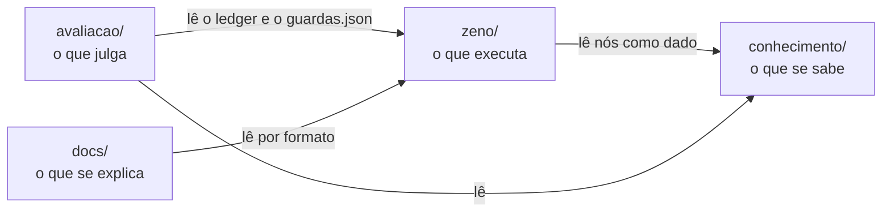
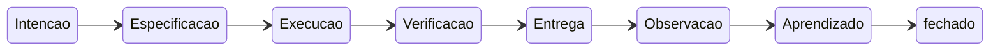
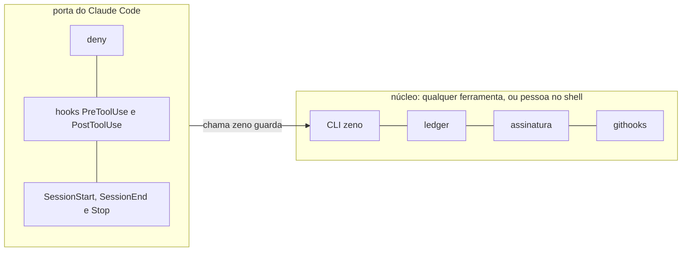

# Os conceitos

> Esta página vem do monorepo de origem do Zeno. Onde ela diz `zeno/`, aqui é a raiz deste repositório; a `avaliacao/` e o `conhecimento/` não vêm nesta publicação.

**Resumo.** O repo separa três poderes: o que se sabe (`conhecimento/`), o que executa (`zeno/`) e o que julga
(`avaliacao/`). No Zeno, todo trabalho é um **nó** que passa por 7 fases. A **faixa** do nó decide quais saídas de fase
passam por pessoa. A segurança vem em 4 camadas, e a mais forte não depende do agente obedecer. O que é de uma
ferramenta de LLM fica numa **porta**, e o núcleo vale para qualquer ferramenta.

Cada seção abaixo se lê sozinha. Os termos estão no [glossário](glossario.md). O contrato exato está na
[spec do Zeno](../spec/README.md).

## Os três poderes

O monorepo separa três poderes e cada poder mora numa raiz, com o próprio código e as próprias regras. A quarta raiz,
`docs/`, é a doc: ela explica e não tem poder. Entre as raízes só cruza **leitura**, por contrato de formato, e nunca
`import` de código (D3).

O `zeno/` lê os nós do `conhecimento/` como dado. A `avaliacao/` lê o ledger do Zeno e o registro de guardas, e é dona
da prova. A `docs/` lê das outras raízes só por formato. O `conhecimento/` não depende de ninguém.

| Raiz | Poder | Começa por |
|---|---|---|
| `conhecimento/` | o hub de context engineering: claims, cards, concepts, sources | [O hub](#o-hub) |
| `zeno/` | o sistema de processos: a CLI `zeno`, o core, os módulos | [`zeno/README.md`](../README.md) |
| `avaliacao/` | benches, placar, fichas de métrica, censo de guardas | `avaliacao/README.md` |
| `docs/` | esta documentação e os portões dela | o padrão |

O Filipe é a constituição: decide as leis do hub, aprova os gates e promove o código que guarda.

## O nó e as 7 fases

Todo trabalho no Zeno é um **nó**: um arquivo Markdown em `.agents/trabalho/<id>.md`, dentro do **alvo** (o repo
onde o Zeno está instalado). Um nó tem pai, filhos e arestas, e por isso o trabalho forma um grafo.

Todo nó passa pelas mesmas 7 fases, em ordem, sem pular nenhuma:

Em texto: Intenção → Especificação → Execução → Verificação → Entrega → Observação → Aprendizado → fechado.

Cada fase responde uma pergunta e deixa um artefato curto no corpo do nó, como `- porque:`, `- pronto:`, `- feito:`,
`- evidencia:`, `- ref:` e `- desfazer:`. O artefato é **proporcional ao tamanho**: num nó `P`, uma linha por fase basta.
Os cartões de cada fase estão em [fases](../spec/fases.md#os-cartões-módulo-nucleo).

**A via expressa** existe para que um nó pequeno não custe mais Zeno do que trabalho. Um nó `P` na faixa `autonoma`
passa as 7 fases com dois comandos: `zeno novo --expressa` e `zeno avancar --ate fim`. O
[tutorial](comecar.md#3-feche-um-nó-pequeno-pela-via-expressa) mostra os dois.

**O estado vive no ledger.** O ledger (`.agents/ledger.jsonl`) é append-only: um evento por linha. A CLI lê o estado do
ledger, e o frontmatter do nó é só uma vista. Editar o frontmatter à mão não muda o estado, e o `zeno validar` acusa a
edição (regra `projecao`); o `zeno validar --reparar` regrava a vista a partir do ledger. Por isso a CLI `zeno` é a
**única porta de escrita** do estado.

**O primeiro ato é abrir o nó (T113).** Num alvo, antes da primeira edição, o agente abre um nó: `zeno novo --expressa`
para um trabalho `P`, ou `zeno contexto <id>` para um nó que já existe. O Zeno não cria nó sozinho, mas cobra o hábito
em dois pontos. No fim da conversa, o hook `Stop` vê no transcript uma edição ou um commit sem nó tocado e pede o
`zeno registrar … --retro`, uma vez por parada e sem impedir a parada. No commit, o `zeno validar --staged` para o
commit de agente sem evento novo de nó e sem nó em Execução, com o mesmo retro pronto na mensagem. A pessoa só leva o
aviso. O desvio vira dado: o placar conta os retros.

## Faixas e gates

A **faixa** é o nível de risco do nó. Ela decide quais saídas de fase passam por pessoa.

| Faixa | O agente | Gates humanos |
|---|---|---|
| `autonoma` | faz | nenhum: todos os gates são `check` |
| `aprovacao` | faz | Especificação (o revisor) e Entrega (o dono) |
| `nunca` | só rascunha: quem executa é pessoa | Especificação, Verificação e Entrega |

O **gate** é a decisão na saída de cada fase. Um gate `check` é determinístico: a chave da fase existe, e os `checks`
do nó saem com 0. Um gate `humano` espera uma pessoa, e o `zeno avancar` sai com o código 3.

A **faixa efetiva** é a que vale. Ela é a mais restritiva entre a faixa declarada, o piso do tamanho (`M` e `G` começam
em `aprovacao`), a faixa das ações do nó e a procedência. Um insumo **não confiável** (web, issue, documento ingerido,
retorno de MCP) sobe o nó para `aprovacao` no mínimo. Um hook marca a sessão como contaminada quando ela usa web ou MCP,
porque o agente injetado é justamente quem não declara a origem. Enquanto houver uma marca ativa no alvo, de qualquer
sessão, todo nó criado no alvo nasce `nao-confiavel`. A marca de uma sessão some no fim dela, e uma pessoa limpa todas
com `zeno gate --descontaminar`. O nó que nasceu marcado continua `nao-confiavel` até uma pessoa ajustar a procedência
(`zeno ajustar <id> procedencia=confiavel --motivo "…"`, assinado). A faixa efetiva é derivada a cada chamada e nunca
escrita. Por isso a via expressa pode ser recusada mesmo num nó `P`: o `zeno novo --expressa` sai com 1, "via expressa
pede faixa efetiva autônoma; esta é aprovacao", e nenhum nó é criado. Se o `zeno status` avisa uma marca de
contaminação ativa, essa é a causa provável; um pai `nao-confiavel`, uma `--origem` não confiável ou uma ação também
sobem a faixa. Crie o nó sem `--expressa` e siga as fases com os gates. O `--descontaminar` não é atalho para a via
expressa: a pessoa só o roda se julgar confiável o que veio da web ou do MCP, e ele limpa as marcas de todas as sessões. Detalhe em [controle](../spec/controle.md#faixas-d13).

**Apertar é livre, e afrouxar é de pessoa.** Qualquer ator pode subir uma faixa ou baixar um orçamento. Baixar uma
faixa, subir um orçamento ou cancelar um nó fora da `autonoma` exige pessoa e um evento assinado. O piso também vale
quando o tamanho sobe (T115): o `zeno ajustar <id> tamanho=M` num P `autonoma` sobe a faixa a `aprovacao` no mesmo
comando, com `motivo: tamanho` no ledger.

**O orçamento** é o teto do nó em tokens, dólares e tentativas. Ele é herdado do pai, e cada alvo tem um teto diário.
Quando um teto estoura, o **disjuntor** pausa o nó e os descendentes, e só um evento assinado de pessoa o tira da pausa: `zeno gate <id> --orcamento dim=+N` ou `zeno gate <id> --despausar --motivo "…"` (T98). Baixar o orçamento não despausa, e nada avança num nó pausado. O disjuntor confere o
consumo quando um gasto é registrado e quando um gate `check` é reprovado. O teto diário não pausa nó: ele trava o alvo
até a virada do dia UTC, e uma pessoa pode liberar só aquele dia com `zeno gate --teto dim=+N`, assinado (T93).

> **Plano (Inc. 4):** o gate `juiz`, um juiz LLM da `avaliacao/`. Hoje a CLI aceita o tipo e sai com 6 (não
> implementado) se ele for o único gate. A promoção de um gate humano para automático vem depois de k casos medidos
> em modo sombra, e o rebaixamento automático vem junto.

## O cartão de decisão

Um gate humano só abre com o **cartão de decisão**: 6 campos em linguagem simples para quem aprova. O cartão existe
porque uma aprovação sem contexto vira carimbo (D36).

| Campo | Pergunta |
|---|---|
| `cartao-muda` | o que muda? |
| `cartao-porque` | por quê? |
| `cartao-risco` | qual é o risco? |
| `cartao-desfazer` | como desfazer? |
| `cartao-reprovar` | o que acontece se reprovar? |
| `cartao-conferir` | de 1 a 3 coisas a conferir |

O lint recusa campo vazio, genérico ("ok", "ver acima") ou com menos de 8 letras. Cada campo cabe em 160 caracteres e
cada item do conferir em 100. O `cartao-risco` começa pelo nível (`alto:`, `baixo:` ou `nenhum:`), que a caixa usa para
decidir o que mostra aberto (D40). A `zeno caixa --aprovar` abre com uma linha por gate e mostra o cartão de quem pede
olho, e a assinatura cobre o texto do nó (`artefato_sha256`). Se o texto mudar depois de aberto, o gate
aparece marcado **MUDOU** e sai do `todos`. Depois do `todos`, a caixa pergunta por ele, e o número o põe no mesmo
lote (T101).

A regra de medida que vem junto: **cada ato humano tem de valer a pena**. Um gate que só repete o que uma guarda já
garante é custo sem proteção e deve ser cortado. O placar mede a espera em gate para achar esses casos. A primeira
grelha dos gates humanos do `zeno/` não achou nenhum: dos 84 conferidos, nenhum repetia uma guarda com sonda, e nada
mudou no código ([controle](../spec/controle.md#a-grelha-dos-gates-humanos)).

## As 4 camadas de segurança

Uma regra que tem de valer sempre fica fora do alcance do agente. Texto no `AGENTS.md` é conselho. As 4 camadas vão
da mais forte para a mais fraca ([seguranca](../spec/seguranca.md)):

1. **Negação declarativa.** Regras de deny no `.claude/settings.json` gerado: o agente não edita o ledger, o fio, a
   configuração nem os gerados. É uma peça da porta do Claude Code.
2. **Hooks fail-closed.** Um hook antes de cada ação chama `zeno guarda pre-tool || exit 2`. Se o zeno falha ou falta,
   a ação é **negada**, e não liberada. O hook tokeniza o comando de shell e nega, por exemplo, escrita por shell num
   arquivo de controle, um verbo de pessoa e `--no-verify`. Desde a T99, ele nega também todo servidor MCP fora da
   lista `mcp:` do alvo (padrão: nenhum), e o deny da camada 1 cobre os MCP de escrita conhecidos. Também é da porta do
   Claude Code.
3. **A CLI.** O estado é lido do ledger. Só um evento assinado vale como decisão humana. Um agente não declara faixa
   abaixo do piso.
4. **Os githooks.** O pre-commit roda `zeno validar --staged` e `zeno sync --check`. Eles pegam o ledger reescrito, a
   assinatura inválida, o gerado com deriva e o commit de agente sem nó (T113). No próprio `zeno/`, ele está em `zeno/.githooks/`. Num alvo, o `sync`
   gera `.agents/githooks/` e liga o `core.hooksPath` só num clone livre; num clone com hooks próprios, avisa como
   encadear (T97). Um hook próprio que chama o gerado (`exec sh .agents/githooks/pre-commit`) conta como encadeado
   (T116). Sem o zeno, o hook falha fechado. O resíduo: a ligação é config local, e um processo do usuário a
   desliga com um `git config`.

**Ambiente não prova pessoa, e a assinatura prova a chave.** TTY, a variável `CLAUDECODE` e o e-mail do git são filtros
que o agente controla. A assinatura Ed25519, com passphrase, prova que quem decidiu tinha a chave e a passphrase. Ela
prova a chave, e não a pessoa: código do agente que roda fora do sandbox alcança, em tese, a chave e o terminal onde a
passphrase é digitada. Rodar o agente no `zeno sessao` (T82) não muda isso sozinho, porque a sessão roda no mesmo
usuário. A marca `sandbox` de cada evento (T105) é declaração, e não prova: um processo de fora, do mesmo usuário,
consegue forjar o marcador da sessão. Só um usuário próprio do agente faria da marca uma prova.

**O código que guarda roda de uma cópia fixada, depois do primeiro `promover`.** Uma pessoa roda `zeno promover`. Ele
roda os testes e o censo num bwrap sem rede (T90), copia o código para fora do clone e grava um evento assinado. Daí em diante, editar
`zeno/core` não muda a guarda até a próxima promoção. Antes da primeira, o shim e os hooks rodam o código do clone, que
o agente pode editar. Na casa, a cópia fixada ainda é do usuário da pessoa, e um agente fora do sandbox consegue trocá-la.
Por isso o código aceita uma cópia do root (T95): com `/opt/zeno` do root, o `promover` assina a cópia provada, e um
instalador root confere a assinatura e o sha256 antes de instalar. Ligar o `/opt/zeno` é o bloco C do
[roteiro da T82](../spec/roteiro-t82.md), um passo com `sudo` que só a pessoa roda.

Cada guarda ativa tem uma sonda que prova que ela dispara, e o censo troca a guarda por `false&&` numa cópia para
provar que a sonda cai junto. As guardas `adiada` ainda não têm. A lista gerada, com o estado de cada uma, está na
[referência](referencia.md#as-guardas-do-zeno).

**O que ainda não está fechado.** Fora do `zeno sessao`, o agente roda com o mesmo usuário do sistema operacional que
a pessoa, e alcança, em tese, o terminal e a passphrase. Dentro dele, a rota que sobra é o código que o agente escreveu
e que roda fora do sandbox. A spec declara essas rotas como resíduos, com nome
([seguranca](../spec/seguranca.md#resíduos-declarados)). O isolamento é o tema da seção
[O agente como entidade](#o-agente-como-entidade).

## O ledger e o placar

O Zeno **registra** e a `avaliacao/` **interpreta**. Todo fato vira um evento no ledger, no formato versionado do
[contrato v1](../spec/ledger.md). O placar da `avaliacao/` lê todos os eventos desse contrato, e um teste confere
a lista do leitor contra a tabela dele. O placar mostra três métricas:

- o **imposto do Sistema**: a fração do esforço gasta com o próprio Zeno, com teto de 15% (D19);
- o **lead time** dos nós;
- a **espera em gate humano**.

Cada métrica tem uma **ficha** (`avaliacao/fichas/`) que diz o que ela mede, o que não mede, a fórmula, os vieses, a
contramétrica e a decisão que ela informa. Com menos de 5 casos num estrato, o placar escreve "n insuficiente" e não conclui nada.

**Fronteira.** Um alvo é `pessoal`, `empresa` ou `cliente`. Dado de alvo `empresa` ou `cliente` nunca entra neste
monorepo: o placar desses alvos é gravado no próprio alvo ou fora do git (D35). A máquina também sabe quais alvos
existem: o registro de alvos (T104) fica fora de qualquer git e junta a fronteira declarada de cada alvo com as regras
por pasta da pessoa. A **fronteira efetiva** é a mais restrita das duas, e um alvo sem nenhuma vale `cliente`. Ela
decide onde a frota age sozinha: o `zeno promover` só sincroniza os alvos de efetiva `pessoal` (T106)
(Registrar os alvos).

## O agente como entidade

O agente é um principal próprio, com identidade, riscos e acessos declarados. Ele não herda as chaves, o ambiente nem o
terminal da pessoa (D37). É isso que deixa o sistema rápido e seguro ao mesmo tempo: autonomia real com risco
calculado.

O que existe hoje:
- o **ator** de cada chamada é resolvido e registrado, nesta ordem. Dentro do `zeno sessao`, é o agente do marcador
  da sessão, e o `ZENO_ATOR` não o troca. Fora dela, vale a variável `ZENO_ATOR`, quando existe (dentro do Claude Code,
  um `ZENO_ATOR` de pessoa é recusado). Depois, `ia:claude` dentro do Claude Code. Depois, a pessoa, só com TTY, e-mail
  do git conhecido e nenhuma CLI de agente acima na árvore de processos. No resto, `ia:desconhecido`
  ([cli](../spec/cli.md#convenções-comuns)). Fora da sessão, o ator é um filtro, e não uma prova;
- o **`zeno sessao <agente>`** (T82, camada A) abre a CLI do agente num bwrap, com o perfil do registro `agentes:` do
  `sistema.yaml`. Dentro dele, a rede sai só por um proxy com allowlist, a casa não aparece, e o controle do git, o
  `.githooks/` e o `.claude/` são só leitura ([cli](../spec/cli.md), a seção do `zeno sessao`);
- com `sessao_obrigatoria: true` no `sistema.yaml`, o hook nega toda ferramenta aberta fora do `zeno sessao`;
- o agente só usa os servidores MCP da lista `mcp:` do `sistema.yaml`, mais os do `mcp:` do perfil dele em `agentes:`
  (T99). Sem lista, nenhum. Vale depois do `promover` e do `zeno sync` de cada alvo;
- verbo de pessoa recusa agente com o código 3, e a assinatura prova a chave;
- o ledger registra qual ator agiu e cada sessão (`sessao.aberta`, `sessao.fechada`). Desde a T105, todo evento leva a
  marca `sandbox`: `fora` quando a CLI não acha o marcador da sessão, e `sessao` quando acha, com o id do
  `sessao.aberta`. A marca `fora` é certa. A marca `sessao` é declaração, porque o marcador é forjável no mesmo usuário.
  Quem cruza as marcas com as sessões é a `avaliacao/`, e o `validar` do alvo não julga a marca.

> **Plano (T82, roteiro):** os passos com root ou login que só o Filipe roda: ligar a cópia do root (bloco C; o código
> já existe, T95), o sandbox do Claude Code para toda sessão e uma chave física, num nó à parte
> ([roteiro](../spec/roteiro-t82.md)).
> As lentes do desenho são quem impõe a regra, o raio de dano, a injeção de prompt, os segredos por portão, a saída de
> rede, a revogação e a detecção.

## As portas

O núcleo do Zeno é agnóstico à ferramenta de LLM (D39). O que só vale dentro de uma ferramenta é uma **porta** dela.
Hoje existe uma porta, a do Claude Code ([portas](../spec/portas.md)).

O núcleo é a CLI, o ledger, a assinatura, o `validar` e os githooks. A porta do Claude Code é o deny e os hooks. Ela
também entrega o bloco de instruções no início da sessão, mede o transcript e dá a deixa do hábito no `Stop` (T113). A
deixa do commit mora no `validar`, e por isso vale sob qualquer ferramenta.

Sob outra ferramenta, sem porta, vale a camada 3, a CLI, e a 4 onde o gate de commit estiver ligado. A assinatura continua
provando quem tem a chave. O contrato mínimo de uma porta nova tem 5 itens. Ela entrega o bloco e tem uma trava antes da ação que falha fechado.
Ela dá um sinal de ator, fica fora do git do time e tem uma sonda que prova tudo isso
([portas](../spec/portas.md#o-contrato-mínimo-de-uma-porta-t83)).

## O hub

O `conhecimento/` é o hub de context engineering: uma base de nós em inglês, um por nota, com o tipo dado pela pasta.
Os tipos são `question`, `source`, `evidence`, `claim`, `concept`, `synthesis`, `card`, `experiment`, `decision`,
`publication` e `front`. Um `claim` tem um grau de certeza. Um `card` tem um anel: `hold`, `assess`, `trial` ou
`adopt`. Cada aresta leva um porquê e a procedência.

O hub responde perguntas com evidência, e não com opinião. Ele guarda as leis L1–L13 como cards de lei, cada um com
anel. As leis vêm da Harness Factory, o projeto de onde o hub nasceu. Três exemplos: a regra fica na camada mais dura, e não em prosa (L3, `trial`); medir em vez de ler (L5,
`adopt`); o contexto mínimo suficiente, com ponteiro em vez de cópia (L7, `trial`). Esta doc segue as leis que cita, mas
nenhum `AGENTS.md` do repo adota as leis como regra. Como consultar o hub está em Consultar o hub.

## O domínio: fluxo, etapa e garantia

O domínio do Zeno é a direção do desenho, escrita em [dominio](../spec/dominio.md). Quase tudo nele ainda é plano.
A frase do desenho: cada trabalho é um nó que cumpre 7 garantias pelo caminho mais barato, e os fluxos são grafos de
etapas versionados que nascem do uso. Hoje existem três partes: o nó com 7 fases, a regra imposta pela máquina na
saída de cada fase e a medida pelo ledger.

> **Plano (spec do domínio, médio prazo):** a fase vira **garantia**, cumprida pelo caminho mais barato: derivada pela
> máquina, herdada do ancestral, escrita pelo agente ou assinada pela pessoa. O **fluxo** é um grafo versionado de
> **etapas**, e cada etapa executada vira um nó com as 7 garantias. Um fluxo que funciona vira **receita** quando uma
> pessoa o promove, e a CLI impõe a receita. O **contrato de fonte de conhecimento** e o **contrato de porta** (5 níveis,
> de operar a isolar) dão forma ao contexto de cada etapa e às portas novas. A **confiança graduada** sobe a força da
> assinatura em degraus: a marca de sandbox (já existe, T105), o sandbox obrigatório, a cópia do root e a chave física.
> Hoje os nós contam como o fluxo implícito, versão 0, e o campo `modulo` do nó é inerte.

Os termos estão no [glossário](glossario.md#termos-do-domínio).

## Existe hoje × plano

| Existe hoje (Inc. 1, fechado em 2026-11-02) | Plano |
|---|---|
| a CLI `zeno`, o ledger v1, nó, fio, as 7 fases e a via expressa | módulos de domínio e captura para o hub (Inc. 3) |
| as faixas, os gates `check` e `humano`, o cartão e a assinatura | o gate `juiz`, a promoção em modo sombra e o rebaixamento (Inc. 4) |
| o orçamento, o disjuntor e o teto diário | o runner assíncrono em sandbox (Inc. 4) |
| as 4 camadas (a 4ª num alvo pelo `.agents/githooks`, T97), a cópia fixada e o código da cópia do root (T95), o censo de guardas e o `zeno sessao` (T82, camada A) | os passos com root da T82 e a chave física (roteiro da T82) |
| a porta do Claude Code, com a deixa do hábito (T113) | portas de outras ferramentas, pelo contrato de porta |
| o registro de alvos e a frota do `promover` (T104, T106) | os painéis federados por fronteira |
| o nó com 7 fases, o fluxo implícito (versão 0) | o fluxo, a etapa, a garantia e a receita ([domínio](#o-domínio-fluxo-etapa-e-garantia)) |
| o placar com 3 métricas e as fichas; a linha de base pelo git (Inc. 2, passo 1, que já existe na `avaliacao/`) | o placar de alvos reais em uso por semanas (o resto do Inc. 2) |

A página de possibilidades diz o que isso abre.
